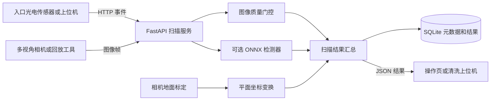

# 车辆感知 POC 软件设计说明

## 1. 目标和范围

本设计说明对应一个预算封顶 50,000 元的相机视觉验证项目。软件用于接收车辆进入事件和多视角图像，记录质量指标，执行可插拔 ONNX 检测，输出经过标定的平面位置、朝向、外形估计和停车状态。

验证范围限定单车道、最多 3 款代表车型、静止或不超过 0.3 m/s 的低速。预计实施 4 至 6 周，客户提供工控机、PLC、供电、网络和相机安装结构。预算拆分与范围见本仓库 `ReadMe.md`，金额为工程估算，不构成供应商报价。

服务不控制清洗执行器，不承担安全联锁，不生成完整三维点云。软件目前通过 HTTP 上传静态图像工作。工业相机 SDK、PLC 硬件数字输入、相机同步触发和现场机械安装需在设备确定后集成。

## 2. 系统结构



组件如下。

| 组件 | 职责 |
| --- | --- |
| FastAPI 服务 | 入口事件、扫描状态、帧上传、标定与结果 REST 接口 |
| 质量门控 | 分辨率、过曝/欠曝裁切和 Laplacian 清晰度检查 |
| ONNX 检测器 | 按固定 `[N,6]` 输出契约检测车辆和关键特征 |
| 几何模块 | 地面单应标定、图像点到毫米坐标映射和角度估计 |
| 汇总模块 | 多视角覆盖、类别状态、位置、方向和停车状态计算 |
| SQLite | 持久化扫描、帧元数据、标定和 JSON 结果 |
| 操作页与回放 CLI | 人工试验、相机上传联调和离线数据重放 |

## 3. 车辆扫描生命周期

1. 入口传感器或上位系统调用 `POST /api/v1/triggers/entry`，服务创建唯一 `scan_id` 并进入 `acquiring` 状态。`active=false` 的事件返回冲突，不创建扫描。
2. 每台相机以 `camera_id`、`view` 和图像帧提交到 `/api/v1/scans/{scan_id}/frames`。服务校验扫描状态、文件大小和图像解码，计算图像质量并在模型可用时执行推理。
3. 帧元数据与检测框写入 SQLite。原始图像在请求结束后释放，不写入本地存储。
4. 上位机调用 `/complete` 后，服务原子地将扫描状态从 `acquiring` 变为 `finalizing`，阻止迟到帧写入。服务汇总视角覆盖、质量状态、检测结果、标定坐标和停车估计，并将扫描状态写为 `ready`、`degraded` 或 `not_ready`。
5. 上位机从 `/result` 读取 JSON。服务不直接向 PLC 输出安全控制信号，也不触发清洗设备动作。

## 4. 相机、触发与环境假设

POC 估算采用 5 个固定图像视角，分别观察车头、车尾、左右侧和车顶。工业全局快门 RGB 相机、定焦镜头、偏振附件和受控补光用于减少运动模糊、眩光和阴影。具体分辨率、镜头焦距、工作距离、同步方式和防护等级需要现场视场设计后确定。

车顶相机用于观察行李架和天线。车头、车尾和侧视角用于外轮廓、前后方向、轮胎和后视镜。直射阳光仍可能导致图像饱和，偏振和补光只能改善部分场景。质量门控会标记不合格帧，不能恢复图像里未采集到的细节。

本版相机入口为 HTTP 图像帧上传。入口传感器通过 REST 事件模拟，硬件 PLC 输入由现场适配器实现。相机在线状态、曝光、增益和触发时序尚未接入厂商 SDK。

## 5. 检测类别和模型契约

默认类别顺序如下。

| 类别 | 语义 |
| --- | --- |
| `vehicle_body` | 可见车身区域 |
| `vehicle_footprint` | 模型预测的地面接地轮廓区域 |
| `front` | 车头特征区域 |
| `rear` | 车尾特征区域 |
| `wheel` | 单个可见车轮 |
| `mirror` | 单个可见后视镜 |
| `roof_rack` | 车顶行李架 |
| `antenna` | 车顶天线 |

模型输入为 RGB、`float32`、`NCHW`，像素值归一化至 `0..1`。预处理直接缩放到固定输入尺寸。输出为 `[N,6]` 或 `[N,6+2K]`，每行前六个字段为 `x1,y1,x2,y2,confidence,class_id`，可选尾部字段为 4 至 128 组轮廓顶点坐标。坐标使用预处理后的模型输入分辨率，服务按缩放比例还原。模型需自行完成 NMS 和轮廓预测，训练与权重导出不在当前代码中。

ONNX 权重由模型训练和数据标注阶段交付，需通过 `ONNX_MODEL_PATH` 配置。模型缺失、加载失败或推理异常时服务不会生成伪检测框。没有被有效图像观测到的特征输出 `unknown`，它不等价于现场确认不存在。

## 6. 标定、坐标和尺寸

每台相机单独存储 3×3 单应矩阵。至少 4 组位于同一地面平面的图像像素点和世界毫米坐标点建立对应关系。标定拟合中位重投影误差超过 10 mm 时请求被拒绝。该误差只描述标定点拟合，不能代表车辆测量误差。

世界坐标系原点、X/Y 正方向由现场地面标记定义，并在所有相机标定中保持一致。有效 `vehicle_footprint` 多边形的质心用于车辆位置，`position_reference` 为 `vehicle_footprint_polygon_centroid`。存在 footprint 框但没有有效轮廓时，位置使用 `vehicle_footprint_bbox_center`，扫描状态保持降级。没有 footprint 时，代码会退回 `vehicle_body` 框底边中点，并标记为 `vehicle_body_bbox_bottom_center`。任何缺失标定的帧都不能用于毫米坐标计算。

朝向由同一帧、同一相机的 `rear` 和 `front` 检测中心转换至世界平面后计算，并标记为基于图像特征中心的估算。角度以世界 X 正方向为零度，逆时针增加至 360 度。任一端点缺失时朝向为 `null`。

`body_envelope` 通过轮廓顶点或检测框四角和地面单应矩阵估算形状，并输出世界坐标 X/Y 方向的包围范围。普通车身框高于地面，地面单应投影可能产生系统偏差，所以该结果标为 `approximate_image_plane_projection`。模型提供 `vehicle_footprint` 轮廓时标为 `estimated_ground_footprint`。POC 输出不会被表述为已验证的真实车身尺寸。

停车区域通过 `PARKING_ZONE_MM=xmin,ymin,xmax,ymax` 配置。只有检测到地面轮廓、必需视角齐全、所有帧通过质量门控、相机完成标定、推理无错误且朝向数据齐备时才计算 `estimated_compliant` 或 `estimated_non_compliant`。其他情况返回 `unknown` 及原因。该估算不可作为清洗设备启停或人身安全判断依据。

## 7. 图像质量门控

每帧记录原图尺寸、平均灰度、高亮裁切比例、阴影裁切比例、Laplacian 方差和门控结果。

| 条件 | 默认判断阈值 | 输出原因 |
| --- | ---: | --- |
| 图像宽度和高度 | 至少 640×360 | `low_resolution` |
| 高亮或阴影极值像素 | 比例不高于 12% | `highlight_clipping` 或 `shadow_clipping` |
| Laplacian 方差 | 至少 15 | `motion_blur_or_low_detail` |

阈值需通过现场样本校准。失败帧保留用于诊断，但不参与位置和关键特征的可信汇总。最终扫描报告 `ready` 需满足存在有效帧、模型已加载、检出车辆和地面轮廓、获得平面位置与方向、必需视角齐全、所有帧通过质量门控且相机标定可用。任何问题会使状态降为 `degraded`。模型不可用时状态为 `not_ready`。

## 8. API 与数据契约

| 方法 | 路径 | 请求或输出 |
| --- | --- | --- |
| `POST` | `/api/v1/triggers/entry` | 入口事件，返回新扫描 |
| `POST` | `/api/v1/scans` | 手动创建扫描 |
| `GET` | `/api/v1/scans` | 最近扫描列表 |
| `GET` | `/api/v1/scans/{scan_id}` | 扫描及其帧记录 |
| `POST` | `/api/v1/scans/{scan_id}/frames` | multipart 字段 `camera_id`、`view`、`file` 和可选带时区 `captured_at` |
| `POST` | `/api/v1/calibrations` | 相机标定点对 |
| `GET` | `/api/v1/calibrations` | 已保存的相机标定 |
| `POST` | `/api/v1/scans/{scan_id}/complete` | 结束采集并汇总 |
| `GET` | `/api/v1/scans/{scan_id}/result` | 完成态结构化结果 |

服务限制上传字节数和解码像素数，要求图像可由 Pillow 和 OpenCV 解码。无时区的 `captured_at` 返回 422，服务不按主机本地时区猜测相机时间。推理失败保留帧质量信息和错误类型，不记录模型异常全文。

完成结果的主要字段如下。`body_envelope.outline_mm` 为按顶点顺序排列的地面坐标数组，每个元素包含 X/Y 毫米坐标。`extent_x_mm` 和 `extent_y_mm` 分别表示多边形在世界 X/Y 轴上的包围范围。

```json
{
  "scan_id": "uuid",
  "status": "ready|degraded|not_ready",
  "position_mm": {"x": 12000.0, "y": 3500.0},
  "position_reference": "vehicle_footprint_polygon_centroid",
  "orientation": {"yaw_degrees": 90.0, "method": "front_to_rear_feature_centers"},
  "body_envelope": {
    "outline_mm": [[10000.0, 5000.0], [11850.0, 5000.0], [11850.0, 9620.0], [10000.0, 9620.0]],
    "extent_x_mm": 1850.0,
    "extent_y_mm": 4620.0
  },
  "parking_compliance": {"status": "unknown", "reasons": []},
  "features": {
    "front": {"status": "observed", "observations": []},
    "wheel": {"status": "unknown", "observations": []},
    "antenna": {"status": "unknown", "observations": []}
  },
  "errors": []
}
```

生产上位机应以 `status` 和字段有效性消费结果。`ready` 代表扫描具有有效帧、模型、车辆与地面轮廓检测、标定位置、方向和完整视角覆盖，且帧质量门控通过。它不代表满足生产验收指标。

## 9. 持久化与隐私

SQLite 保存扫描主表、帧质量/检测元数据、相机标定矩阵及最终结果 JSON。上传图像只在内存中解码和推理，不持久化图像、车牌或原始视频。部署方应将数据库目录限制在本机访问范围并执行留存周期管理。

该服务未实现多租户身份鉴权、TLS 终止、分布式数据库、高可用或远程用户授权。生产部署须由现场网关提供访问控制和网络隔离。

## 10. 性能目标

| 项目 | POC 联调目标 | 状态 |
| --- | ---: | --- |
| 单帧质量分析加 ONNX 推理 | P95 ≤ 1 秒 | 尚未在目标 IPC 和目标模型测量 |
| 最后一帧进入后的扫描汇总 | ≤ 2 秒 | 尚未在现场负载下测量 |
| REST 状态查询 | P95 ≤ 100 ms | 尚未在现场数据库负载下测量 |

实际时间取决于相机传输、模型大小、CPU/GPU、并发帧数和现场网络。本代码在 CPU provider 上运行 ONNX，不提供毫秒级多相机同步保证。正式验收需记录每帧采集时间、推理时间、扫描耗时以及 P50/P95/P99。

## 11. 5 万元预算与里程碑

预算上限为 50,000 元，估算项目为样本与验收对齐 5,000 元、相机与光学附件 18,000 元、软件和模型适配 19,000 元、现场安装标定 8,000 元。5,000 元可行性阶段计入总额并在继续实施时抵扣后续款项。这一抵扣方式是预算编排假设，正式商务条款应以签约报价单为准。

| 周期 | 交付 | 停止条件 |
| --- | --- | --- |
| 第 1 周 | 现场视场确认、样本采集、强光条件基线 | 不能稳定观察关键部位时停止并复核方案 |
| 第 2 至 3 周 | 相机布置、标注样本、模型适配、软件联调 | 关键类别样本不足时补采，不承诺分类准确率 |
| 第 4 至 5 周 | 标定、图像回放、三款车型测试和误差统计 | 质量门控连续失败时调整相机/遮光/补光 |
| 第 6 周 | 验收报告、问题清单和生产化差距评估 | 未通过双方约定的 POC 指标时不扩为生产系统 |

阶段验收应包含各类别 precision/recall、漏检与误检样例、视角覆盖、图像质量失败比例、独立真值位置与角度误差、不同光照对比及连续运行记录。单一总体“识别率”不能替代逐类别指标。

## 12. 非目标和生产化工作

POC 不承诺识别率达到 95%、P95 位置误差不超过 20 mm、完整三维点云重建、清洗设备执行器控制、安全联锁、全部车型覆盖、任意天气性能或生产环境长期可用性。

后续生产阶段需确定相机与激光/深度传感器取舍，完成标注数据闭环、相机 SDK 与硬件触发、独立真值测量、逐类别指标验收、环境压力测试、冗余与故障安全设计、PLC 联锁审查和长期稳定性测试。POC 的软件验收不能替代这些工作。
